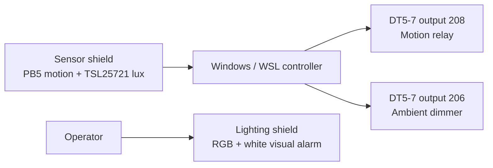

# NuMaker home motion exterior light

This reference design uses three NDA102SD2 evaluation boards. A Windows/WSL host reads the sensor board and controls the DT5-7 shield. The lighting shield provides RGB and tunable-white effects, including a separately triggered visual alarm. Each SSD1306 OLED rotates between the Nuvoton × Winbond splash and a description of its board.

| Board | USB role | Inputs and outputs |
| --- | --- | --- |
| Sensor shield | Sensor port, detected by the monitor | TSL25721 at I²C `0x39` on PC0 SDA and PC1 SCL. PB5 is the prototype's motion input. The OLED uses PB0/PB1 on the tested shield. |
| DT5-7 shield | COM5 | Output 208 uses the PC2 relay. Output 206 uses PA6 20 kHz PWM. |
| Lighting shield | COM3 | Drives the RGB and warm/cool white channels, including native hardware color cycling and an optional strobe. |



## Control behavior

- **208 motion relay.** PB5 ADC readings above 1800 turn the relay on and renew a 30-second minimum hold. The relay can turn off once the hold expires and PB5 drops below 100. Readings in between preserve its current state. If acquisition stops, the relay switches off after the remaining hold.
- **206 ambient dimmer.** The target PWM duty is `round(100 × 400 / (400 + lux))`. It reaches 100% at 0 lux, 50% at 400 lux, and about 5% at 7,000 lux. The controller ramps toward the target and keeps the last duty if lux data is unavailable.
- **RGB and white.** The demonstration cycles six RGB colors and alternates warm and cool white every 40 ms. The opt-in alarm flashes red and cool white together at two flashes per second and stops at the requested duration. Ordinary PIR activity controls 208.
- **OLEDs.** The four-second logo and six-second description repeat on each board. Sensor readings and output control continue during both pages. The Windows live monitor shows the current lux and raw motion input.

The tested DT5-7 shield uses active-low PC2. Check the physical relay indication and output on your shield before relying on that polarity. The host reads PC2 back and compensates for firmware that reports the opposite ON/OFF labels. PWM duty is the value the controller commands. Light output and fixture behavior depend on the connected driver and load.

## Build and program

Use WSL with Windows PowerShell 5.1, the Nuvoton Nu-Link Command Tool, GNU Arm Embedded tools (`arm-none-eabi-gcc`, `objcopy`, and `size`), Python 3.11 or later, and DejaVu Sans Mono. Assign COM3 to the lighting board and COM5 to DT5-7 in Windows. The sensor monitor finds the remaining Nu-Link virtual COM port.

```bash
python3 -m venv .venv
source .venv/bin/activate
python3 -m pip install -r requirements.txt
python3 tools/build.py --profile lighting
python3 tools/build.py --profile dt57 --relay-active-level 0
python3 tools/build.py --profile sensor
```

On Windows, run `tools/backup-boards.ps1 -NuLinkIds <id>` for each board with a nonzero debugger ID. Run `tools/flash.ps1 -NuLinkId <id> -Firmware build/numaker-control.bin` for the lighting board and use `build/numaker-dt57.bin` for DT5-7. Substitute the ID from your own Nu-Link. For a sensor board with debugger ID zero, connect it alone, use `tools/backup-boards.ps1 -IsolatedZeroId`, then run `tools/flash.ps1 -IsolatedZeroId -Firmware build/numaker-sensor.bin`.

## Run the reference design

From the example directory in WSL, with the virtual environment active:

```bash
python3 tools/lighting_demo.py prepare
powershell.exe -NoProfile -ExecutionPolicy Bypass -File tools/open-sensor-live.ps1
python3 tools/pb5_relay.py --start
python3 tools/pb5_relay.py --status
python3 tools/lighting_demo.py show
```

The foreground lighting show owns COM3. Press Ctrl+C to stop it before launching the visual alarm or sending direct commands to the lighting board. The two background workers continue sensing and controlling the other outputs.

```bash
python3 tools/lighting_demo.py alarm --seconds 10
python3 tools/lighting_demo.py off
```

The alarm turns the LEDs off when it finishes. Run `show` again to resume the lighting-board OLED rotation and color cycle. `python3 tools/pb5_relay.py --stop` stops automatic control of COM5 and leaves its last output settings in place. The Windows monitor launcher accepts `-Stop` to stop sensor acquisition and close the monitor.

## Verify

```bash
python3 -m unittest tools.test_pb5_relay muse_bridge.test_executor muse_bridge.test_palette muse_bridge.test_show muse_bridge.test_worker
```

With the boards connected, move in and out of the sensor's view and check the 208 hold and relay readback in `build/pb5-relay-state.json`. Shade and illuminate the TSL25721 while observing its lux and the 206 PWM duty. Check both OLED pages on each board. The firmware uses local GPIO and PWM on these shields, with USB serial between the host and boards.

The TSL25721 register settings and lux conversion are implemented from the ams OSRAM TSL2572 datasheet. See the [OpenNuvoton DALI ecosystem overview](https://www.nuvoton.com/applications/industrial/dali-ecosystem-control-gears-and-devices/) for the platform and [NuTool-PinConfigure](https://github.com/OpenNuvoton/NuTool-PinConfigure) for the NDA102 pin multiplexer. The rasterized firmware font is covered by [its DejaVu license](reference/font-license.txt).
