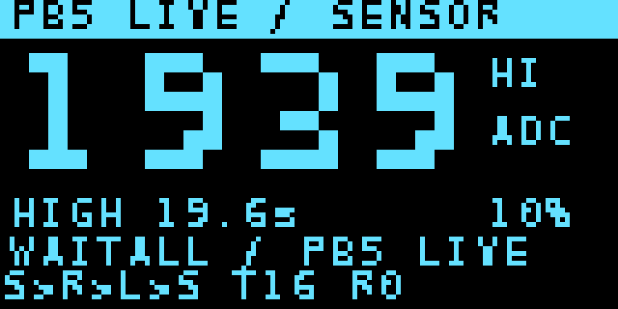

# Bench record and practical limits

## Completed software and bench checks

The three normal standalone images were programmed and APROM-verified on 11 November 2026. A read-only observer completed at 20:00:16 UTC with all three nodes at `WARMUP_MS=0`, `READY_MASK=7`. It closed all host serial ports for 12 seconds, then observed continued application traffic and both source sampling counters advancing. USB cables remained connected throughout that experiment.

The latest sensor-only large-PB5 diagnostic was programmed and APROM-verified at 20:43:36 UTC. It displays 28-pixel-high raw ADC digits, current electrical-level duration and last completed HIGH duration. A native simulated 19.6-second interval is checked by its sensor fixture.

| Firmware variant | SHA256 of bench-built image |
| --- | --- |
| Normal sensor | `02b952f87511995fdefce76363d22d8f569a59f58878accbcaee7ac53e3eca08` |
| Normal DT5-7 relay | `8f50bc074905ce6585eddc6963ced6aef3771f21152e6b8232e5e0582356f3ce` |
| Lighting, G/B swap | `8015e6027ed5921c9e5bccd42fc36e5eee1033fbd1bebe984589edd0565ecf97` |
| Sensor PB5 display | `8b613ecedf656fc872202044d59e7970370005d872f452882c02a1026b17867f` |

These identify historical bench builds, not a reproducible-build promise for another compiler or subsequent diagnostics changes. Current source and the verification runner define the submitted implementation.

Native tests exercise real C UART/parser/application code with simulated clocks and registers: 5120 UART receive frames across sampling phases, TX/framing/overflow/pin restore, three-node CRC/TTL/routing/backpressure, readiness/reboot, fixed first-trigger deadlines, rearming, independent sensor failures, fixed dimmer output and PB5 timing. These simulations do not qualify electrical behavior.

## Open PIR observation

PB5 usually clusters near 1 and 1900+ ADC counts. A recorded cover/uncover trial produced a completed raw HIGH interval of **19611 ms**, consistent with the user's roughly 19.6-second observation. Many earlier pulses lasted around 5–7 seconds. Sampling and packet transfer continued while PB5 remained high.

The fixed output interval ends at 10 seconds; another first-trigger event requires PB5 to clear and rise again. A long raw HIGH can therefore look like a delay in accepting new motion. Separate software state for lux and PIR does not establish that the physical sensor, lamp or power paths are independent.

The exact PIR module part, shield output circuit, active polarity and GPIO digital threshold compatibility remain unconfirmed. Reading PB5 with an ADC does not establish that it is an analog motion-strength output. Measure the voltage and identify the sensor circuit before replacing the ADC read with a digital GPIO read.

The fixed-60% relay diagnostic is built and native-tested but its bench deployment is pending. Compare repeated cover/uncover trials with normal ambient control versus fixed duty while logging PB5, lux, actual PWM, event ID and sample counters. Let startup and white fade settle. A result difference identifies an output-related effect; additional controls are needed to distinguish hand/PIR retriggering, optical/thermal lamp feedback and supply effects.

## Power and timing limits

- Closing serial ports verifies absence of host control commands. It does not prove operation with USB cables removed or adequate external supplies/common ground.
- The ring carries a full 26-byte frame in 260 ms per hop. End-to-end response includes sampling, a 1 Hz publisher and service latency.
- Receiver elapsed-time compensation approximates frame airtime; there is no shared synchronized clock.
- Raw-level duration measurements are sampled and have sampling/communication uncertainty.
- RGB green/blue swap and relay active level were verified on the tested shields. Other revisions require confirmation.

The image above comes from the native OLED renderer, not a hardware photograph. The smaller normal dashboard assets in this directory are captured framebuffers from the verified earlier deployment.
